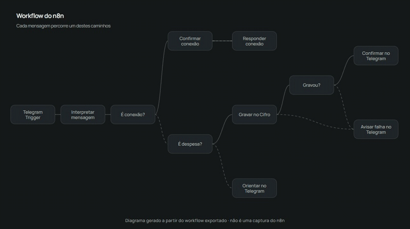
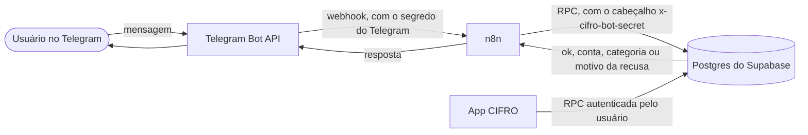
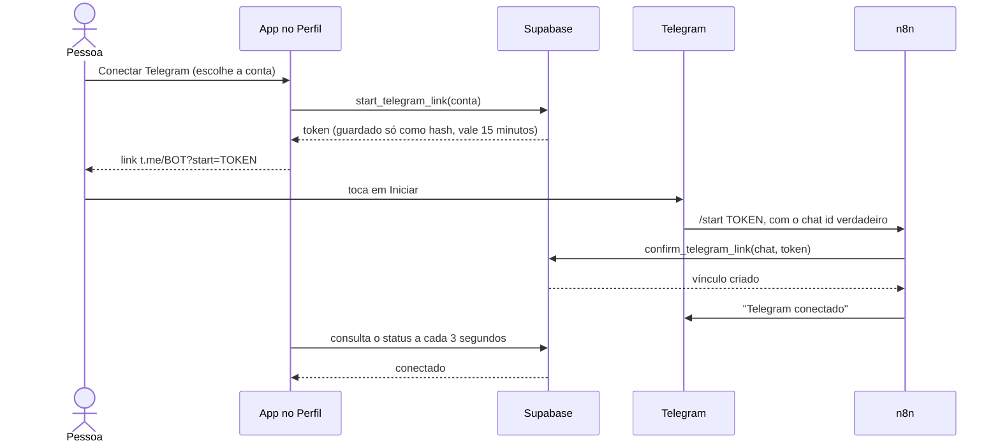

# CIFRO · Automação de despesas pelo Telegram

Mande `almoço 32,50` para um bot e a despesa entra na conta certa do usuário, com categoria, data e confirmação. É a automação do [CIFRO](https://github.com/Rafaelgs2/CIFRO-APP), um app de finanças pessoais em Next.js e Supabase, e este repositório isola e documenta só ela.

> **In English:** a Telegram → n8n → Supabase automation that records expenses from chat messages. It links each chat to a user with a one-time token, authenticates the bot with a single hashed secret (no service-role key), is idempotent per message, and is covered by a 101-scenario SQL test suite. This repository is a showcase of the design, not a template to install. Documentation is in Portuguese.

## O que ele faz

- Registra uma despesa a partir de uma mensagem livre (`descrição valor`), em um chat privado.
- Descobre sozinho de qual usuário é o chat: a pessoa conecta o Telegram uma vez, por um link de uso único gerado no app.
- Escolhe a categoria pelas palavras da descrição e responde com a conta e a categoria usadas.
- Funciona para vários usuários ao mesmo tempo, sem que um enxergue ou escreva nos dados do outro.

## Demonstração

> **Simulação com dados fictícios.** Os GIFs abaixo usam a interface real do CIFRO com dados de exemplo, um celular simulado no lugar do Telegram e um diagrama do workflow exportado. Não são gravações do bot em uso. [Como foram gerados](docs/media/src/README.md).

**Conectar o Telegram:** o app gera o link de uso único, a pessoa toca em Iniciar, e o Perfil muda sozinho para Conectado.


**Registrar despesas:** duas mensagens viram dois lançamentos, com a conta e a categoria confirmadas pelo bot.


**O caminho de uma mensagem no workflow:** do gatilho até a confirmação, pelos ramos de conexão, gravação e erro.



## Arquitetura



A parte menos óbvia é descobrir de quem é o chat sem confiar em nada digitado pelo usuário:



O token prova a conta logada no app. O chat id vem do próprio Telegram. Só quem controla os dois lados consegue completar o vínculo.

## O que o projeto demonstra

| Competência | Onde está |
| --- | --- |
| Webhooks e orquestração | [`workflows/cifro-telegram.json`](workflows/cifro-telegram.json): ramos de conexão, gravação e erro; falha de rede e recusa de negócio chegam ao usuário como mensagens |
| Identidade entre sistemas | Link de uso único em [`202610300004`](db/migrations/bot/202610300004_telegram_multi_user.sql); o banco decide o dono de cada chat |
| Segurança sem service-role key | Funções `security definer` com `search_path` vazio e `revoke` explícito; o bot se autentica por um segredo único, guardado como hash |
| Idempotência | O id do evento é derivado de `md5(chat:mensagem)`, então reenvio não duplica |
| Integridade dos dados | As regras do app são aplicadas na função; um teste de controle prova por que `set constraints all immediate` é necessário |
| Testes | [Suíte SQL](db/tests) com 101 cenários, isolamento entre usuários e casos de abuso |
| Operação e honestidade | [Limitações conhecidas](docs/estudo-de-caso.md#limitações-conhecidas) escritas sem maquiagem |

O raciocínio por trás de cada decisão, os erros cometidos no caminho e o modelo de ameaças estão no [estudo de caso](docs/estudo-de-caso.md).

## Como foi testado

A suíte é SQL puro, em [`db/tests`](db/tests), executada sobre um Postgres descartável que emula as partes do Supabase de que o schema depende. Tem **101 cenários em 13 grupos**: autenticação do bot, privilégios, vínculo, captura, categorias, validações, idempotência, isolamento entre usuários, troca de conta, convivência com o app, limpeza e um teste de controle.

- As chamadas rodam sob os papéis reais (`anon`, `authenticated`, `supabase_auth_admin`), porque boa parte dos erros que importam aqui é de permissão.
- Falhas esperadas são afirmadas explicitamente, então qualquer erro não previsto interrompe a execução em vez de passar em silêncio.
- Para confirmar que a suíte detecta problemas, quebrei a migration de propósito de duas formas (removi uma linha de integridade e tornei a autorização do bot sempre verdadeira) e ela falhou nas duas. Essa verificação foi manual.

## O workflow

[`workflows/cifro-telegram.json`](workflows/cifro-telegram.json) é o workflow do n8n exportado, com 11 nós: um ramo para conectar o Telegram, um para gravar a despesa e ramos de erro que sempre acabam em uma resposta ao usuário. Foi publicado **sem ids de credencial, URL de projeto, token nem chat id**; um script de sanitização recusa gravar qualquer exportação que ainda pareça conter um segredo.

## Estrutura

```
db/migrations/core/   schema e RPCs do app CIFRO, copiados sem alteração
db/migrations/bot/    as quatro migrations da automação
db/stub-supabase.sql  papéis, auth.uid() e privilégios padrão do Supabase
db/tests/             suíte SQL, executada em uma única sessão do psql
workflows/            workflow do n8n, sanitizado
scripts/              utilitários de desenvolvimento: execução dos testes e sanitização do workflow
docs/                 estudo de caso e mídia do README
```

As migrations de `core/` vêm do repositório do CIFRO (commit `0cd86a1`) e existem aqui para a suíte ser executada contra o schema real. As de `bot/` mostram a evolução: a `0004` substitui o desenho da `0001`, e o [estudo de caso](docs/estudo-de-caso.md) explica por quê.

## Limitações conhecidas

- No uso real, o n8n roda em um computador pessoal atrás de um túnel temporário. Quando a máquina reinicia, o bot para.
- Não há limite de envio por usuário.
- O segredo do bot é único para todos os usuários. Se vazar, permite lançar despesas em chats conectados, mas não ler nem apagar dados, e é trocado com um comando.
- A categoria é um palpite por palavra-chave, corrigível no app.
- Os testes cobrem o banco. O workflow do n8n foi conferido importando-o em um n8n limpo e usando-o com um bot real, não por teste automatizado.

## Licença

[MIT](LICENSE).
