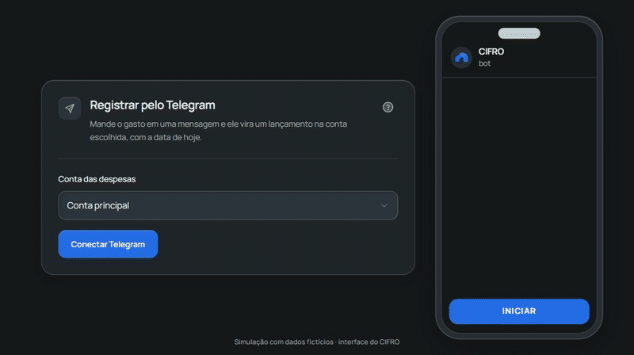
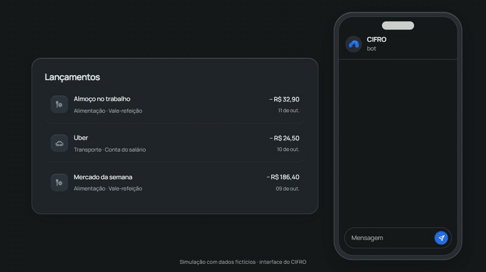
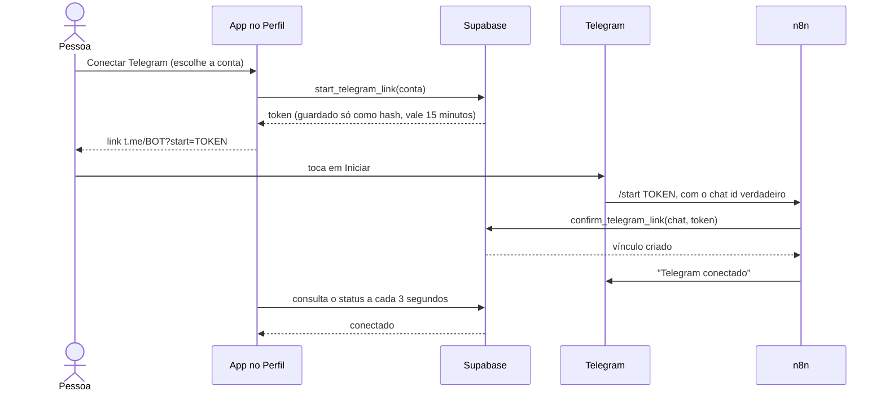

# CIFRO · Automação de despesas pelo Telegram

Mande `almoço 32,50` para um bot e a despesa entra na conta certa do usuário, com categoria, data e confirmação. É a automação do [CIFRO](https://github.com/Rafaelgs2/CIFRO-APP), um app de finanças pessoais em Next.js e Supabase, e este repositório isola e documenta só ela.

> **In English:** a Telegram → n8n → Supabase automation that records expenses from chat messages. It links each chat to a user with a one-time token, authenticates the bot with a single hashed secret (no service-role key), is idempotent per message, and ships with a 101-scenario SQL test suite that runs with one command. Documentation is in Portuguese.

## O que ele faz

- Registra uma despesa a partir de uma mensagem livre (`descrição valor`), em um chat privado.
- Descobre sozinho de qual usuário é o chat: a pessoa conecta o Telegram uma vez, por um link de uso único gerado no app.
- Escolhe a categoria pelas palavras da descrição e responde com a conta e a categoria usadas.
- Funciona para vários usuários ao mesmo tempo, sem que um enxergue ou escreva nos dados do outro.

<!-- Quando os arquivos existirem em docs/media/, descomente:


-->

## Arquitetura


A parte menos óbvia é descobrir de quem é o chat sem confiar em nada digitado pelo usuário:



O token prova a conta logada no app. O chat id vem do próprio Telegram. Só quem controla os dois lados consegue completar o vínculo.

## O que o projeto demonstra

| Competência | Onde está |
| --- | --- |
| Webhooks e orquestração | [`workflows/cifro-telegram.json`](workflows/cifro-telegram.json): ramos de conexão, gravação e erro; falha de rede e recusa de negócio chegam ao usuário como mensagens |
| Identidade entre sistemas | Link de uso único em [`202610300004`](db/migrations/bot/202610300004_telegram_multi_user.sql); o banco decide o dono de cada chat |
| Segurança sem service-role key | Funções `security definer` com `search_path` vazio e `revoke` explícito; o bot se autentica por um segredo único, guardado como hash |
| Idempotência | O id do evento é derivado de `md5(chat:mensagem)`, então reenvio não duplica |
| Integridade dos dados | As regras do app são aplicadas na função; um teste de controle prova por que `set constraints all immediate` é necessário |
| Testes | [Suíte SQL](db/tests) com 101 cenários, isolamento entre usuários e casos de abuso |
| Operação e honestidade | [Limitações conhecidas](docs/estudo-de-caso.md#limitações-conhecidas) escritas sem maquiagem |

O raciocínio por trás de cada decisão, os erros cometidos no caminho e o modelo de ameaças estão no [estudo de caso](docs/estudo-de-caso.md).

## Rodar os testes

Só precisa de Docker.

```bash
bash scripts/run-tests.sh
```

O script sobe um Postgres descartável, emula as partes do Supabase de que o schema depende ([`db/stub-supabase.sql`](db/stub-supabase.sql)), aplica as migrations e roda a suíte. Leva cerca de 20 segundos e termina com código diferente de zero se qualquer cenário falhar. Saída esperada, ao final:

```
RESULTADO: 101/101 cenários passaram
```

Os cenários são agrupados por tema: autenticação do bot, privilégios, vínculo, captura, categorias, validações, idempotência, isolamento entre usuários, troca de conta, convivência com o app, limpeza e o teste de controle.

## Usar o workflow no n8n

1. Suba um n8n de teste, sem tocar no seu: `docker compose --profile n8n up -d n8n` (fica em `http://localhost:5679`).
2. Importe [`workflows/cifro-telegram.json`](workflows/cifro-telegram.json).
3. Crie a credencial **Telegram** com o token do seu bot, que fica só no n8n.
4. Crie uma credencial **Custom Auth** e selecione-a nos nós **Confirmar conexão** e **Gravar no Cifro**:

   ```json
   { "headers": { "apikey": "SUA_PUBLISHABLE_KEY", "x-cifro-bot-secret": "SEGREDO_DO_BOT" } }
   ```

5. Troque `https://YOUR-PROJECT.supabase.co` pela URL do seu projeto nesses dois nós.
6. Gere o segredo do bot no SQL Editor do Supabase (`select public.rotate_telegram_bot_secret();`) e publique o workflow.

O workflow publicado aqui não contém ids de credencial, URL de projeto, token nem chat id. O script [`scripts/sanitize-workflow.cjs`](scripts/sanitize-workflow.cjs) recusa gravar qualquer exportação que ainda pareça conter um segredo.

## Estrutura

```
db/migrations/core/   schema e RPCs do app CIFRO, copiados sem alteração
db/migrations/bot/    as quatro migrations da automação
db/stub-supabase.sql  papéis, auth.uid() e privilégios padrão do Supabase
db/tests/             suíte SQL, executada em uma única sessão do psql
workflows/            workflow do n8n, sanitizado
scripts/              run-tests.sh e sanitize-workflow.cjs
docs/                 estudo de caso e roteiro das gravações
```

As migrations de `core/` vêm do repositório do CIFRO (commit `0cd86a1`) e existem aqui só para a suíte rodar contra o schema real. As de `bot/` mostram a evolução: a `0004` substitui o desenho da `0001`, e o [estudo de caso](docs/estudo-de-caso.md) explica por quê.

## Limitações conhecidas

- No uso real, o n8n roda em um computador pessoal atrás de um túnel temporário. Quando a máquina reinicia, o bot para.
- Não há limite de envio por usuário.
- O segredo do bot é único para todos os usuários. Se vazar, permite lançar despesas em chats conectados, mas não ler nem apagar dados, e é trocado com um comando.
- A categoria é um palpite por palavra-chave, corrigível no app.
- Os testes cobrem o banco. O workflow do n8n foi conferido importando-o em um n8n limpo e usando-o com um bot real, não por teste automatizado.

## Licença

[MIT](LICENSE).
